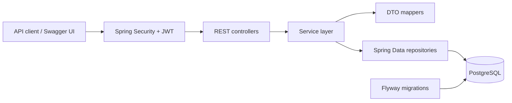

# E-Commerce REST API

A REST API for an online store, built with Java 17 and Spring Boot. It includes JWT-based authentication, role-protected catalog management, customer carts, transactional checkout, PostgreSQL persistence, and versioned database migrations.

## Features

- User registration and login with BCrypt password hashing
- Short-lived JWT access tokens and rotating refresh tokens, with an absolute session lifetime and a per-user session cap
- Per-IP rate limiting for authentication endpoints
- `USER` and `ADMIN` authorization
- Product and category CRUD; catalog writes are restricted to admins
- Product search, category/price/stock filters, sorting, and pagination
- Per-user shopping carts
- Atomic cart checkout with row-level stock locking and `409 Conflict` for insufficient stock
- Order status lifecycle for admins and customer cancellation with stock restoration
- Bean Validation and consistent JSON error responses
- PostgreSQL schema managed by Flyway; Hibernate validates mappings at startup
- OpenAPI documentation and Swagger UI
- Actuator health endpoint for deployment checks
- JUnit 5, MockMvc, and opt-in PostgreSQL integration tests

## Technology

Java 17 · Spring Boot 3.5 · Spring Security · Spring Data JPA · PostgreSQL 16 · Flyway · Lombok · Springdoc OpenAPI · JUnit 5 · Docker Compose

## Architecture



Controllers handle HTTP input/output, services enforce business rules, repositories persist entities, and DTOs keep the API contract separate from database entities.

## Requirements

- JDK 17
- Docker Desktop / Docker Engine with Compose
- PowerShell on Windows, or a POSIX-compatible shell on Linux/macOS

## Run locally

From the `ecommerce-api/` directory:

```powershell
if (-not (Test-Path .env)) { Copy-Item .env.example .env }
docker compose up -d postgres
```

Compose reads `.env` to configure the local PostgreSQL container. When running the Spring Boot app directly on the host, export the matching database settings to the process environment as well; Spring Boot does not load a `.env` file automatically.

```powershell
$env:SPRING_PROFILES_ACTIVE = 'dev'
$env:POSTGRES_HOST = 'localhost'
$env:POSTGRES_PORT = '5433'
$env:POSTGRES_DB = 'ecommerce'
$env:POSTGRES_USER = 'postgres'
$env:POSTGRES_PASSWORD = 'postgres'
```

Start the API:

```powershell
.\mvnw.cmd spring-boot:run
```

The application no longer falls back to the `dev` profile automatically. Set `SPRING_PROFILES_ACTIVE=dev` locally. For a production-like run, set `SPRING_PROFILES_ACTIVE=prod` and provide `DB_URL`, `DB_USERNAME`, `DB_PASSWORD`, and `JWT_SECRET` through environment variables or a secret manager.

Flyway applies pending migrations on startup. Hibernate then validates that the entity mappings match the database schema.

### Configuration

| Variable | Local default | Purpose |
| --- | --- | --- |
| `POSTGRES_HOST` | `localhost` | PostgreSQL host for the API process |
| `POSTGRES_PORT` | `5433` | Host port mapped to PostgreSQL's container port `5432` |
| `POSTGRES_DB` | `ecommerce` | Database name |
| `POSTGRES_USER` | `postgres` | Database user |
| `POSTGRES_PASSWORD` | `postgres` | Local-only database password |
| `JWT_SECRET` | Development-only value in the `dev` profile | HMAC signing key; supply a strong secret outside development |
| `JWT_ISSUER` | `ecommerce-api` | JWT issuer claim |
| `JWT_EXPIRATION` | `PT15M` | Access-token lifetime |
| `JWT_REFRESH_EXPIRATION` | `P7D` | Refresh-token lifetime |
| `JWT_ABSOLUTE_REFRESH_EXPIRATION` | `P30D` | Maximum lifetime of a login session across refresh rotations |
| `JWT_MAX_SESSIONS_PER_USER` | `5` | Maximum number of concurrent refresh-token families per user; the oldest is revoked first |
| `SERVER_PORT` | `8080` | HTTP port |
| `SPRING_PROFILES_ACTIVE` | none | Required; use `dev` locally, `prod` in production |
| `CORS_ALLOWED_ORIGINS` | `http://localhost:3000` | Comma-separated list of allowed browser origins |
| `RATE_LIMIT_ENABLED` | `true` | Enable per-IP authentication rate limiting |
| `RATE_LIMIT_AUTH_MAX_REQUESTS` | `10` | Maximum auth requests per IP and window |
| `RATE_LIMIT_AUTH_WINDOW` | `PT1M` | Rate-limit window duration |
| `BOOTSTRAP_ADMIN_EMAIL` | empty | Optional dev-only first admin email |
| `BOOTSTRAP_ADMIN_PASSWORD` | empty | Optional dev-only first admin password (min 8 chars) |
| `DB_URL`, `DB_USERNAME`, `DB_PASSWORD` | none | Required when running with the `prod` profile |

The values in `.env.example` are for local development only. Do not use the sample database password or development JWT secret in a deployed environment. Set production secrets through your deployment platform's secret manager or environment variables.

## API overview

| Method | Endpoint | Access | Description |
| --- | --- | --- | --- |
| `POST` | `/api/auth/register` | Public | Register a user |
| `POST` | `/api/auth/login` | Public | Sign in and receive access/refresh tokens |
| `POST` | `/api/auth/refresh` | Public | Rotate a refresh token |
| `POST` | `/api/auth/logout` | Public | Revoke a refresh-token family |
| `GET` | `/api/auth/me` | Authenticated | Get the current user's profile |
| `GET` | `/api/products` | Public | Search and list active products |
| `GET` | `/api/products/{id}` | Public | Get a product |
| `POST`, `PUT`, `DELETE` | `/api/products/**` | `ADMIN` | Create, update, or deactivate a product |
| `GET` | `/api/categories` and `/api/categories/{id}` | Public | Browse categories |
| `POST`, `PUT`, `DELETE` | `/api/categories/**` | `ADMIN` | Manage categories |
| `GET`, `POST`, `PUT`, `DELETE` | `/api/cart/**` | Authenticated | Read and manage the current user's cart |
| `POST` | `/api/orders/checkout` | Authenticated | Check out the current user's cart |
| `GET` | `/api/orders` and `/api/orders/{id}` | Authenticated | List or view the current user's orders |
| `POST` | `/api/orders/{id}/cancel` | Authenticated | Cancel a pending or confirmed order and restore stock |
| `GET` | `/api/admin/orders` and `/api/admin/orders/{id}` | `ADMIN` | List or view all orders |
| `PATCH` | `/api/admin/orders/{id}/status` | `ADMIN` | Advance or cancel an order |
| `GET` | `/actuator/health` | Public | Application and database health check |

Product list query parameters include `q`, `categoryId`, `minPrice`, `maxPrice`, `minStock`, `maxStock`, `page`, `size`, and `sort`. For example:

```text
GET /api/products?q=phone&minPrice=10&maxPrice=100&minStock=1&page=0&size=20&sort=price,asc
```

The maximum page size is 100. Invalid input returns `400`; missing resources return `404`; insufficient stock and conflicting data return `409`. Error responses use the shared `ApiError` structure and include `fieldErrors` for validation failures.

Order status transitions are `PENDING → CONFIRMED → SHIPPED → DELIVERED`; `PENDING` and `CONFIRMED` orders can also be cancelled. Invalid transitions return `409 Conflict`. Cancelling an order restores reserved stock.

Authentication endpoints are rate limited per client IP in memory. This protects a single instance; multi-instance deployments should use a shared limiter such as Redis or an API gateway.

## API documentation

With the application running:

- Swagger UI: <http://localhost:8080/swagger-ui/index.html>
- OpenAPI JSON: <http://localhost:8080/v3/api-docs>

Use **Authorize** in Swagger UI to supply an access token for protected routes. Product and category reads are public; write operations require an `ADMIN` token.

## Tests

Run unit and MVC tests without PostgreSQL:

```powershell
.\mvnw.cmd test
```

PostgreSQL integration tests are opt-in. They check Flyway migrations, JPA mappings, real database filtering/pagination, role authorization, OpenAPI generation, and checkout atomicity. Use a **separate test database**:

```powershell
docker compose up -d postgres
docker compose exec postgres createdb -U postgres ecommerce_test
$env:TEST_DATABASE_URL = 'jdbc:postgresql://localhost:5433/ecommerce_test'
$env:TEST_DATABASE_USERNAME = 'postgres'
$env:TEST_DATABASE_PASSWORD = 'postgres'
.\mvnw.cmd '-Dpostgres.integration=true' test
```

Change the test connection variables to match your `.env` if you use different credentials. Never point integration tests at production or a database containing data that must be preserved.

## Database migrations

Migrations are in `src/main/resources/db/migration/` and run automatically at application startup:

- `V1__init_schema.sql` — core tables, constraints, and indexes
- `V2__seed_roles.sql` — `USER` and `ADMIN` roles
- `V3__create_refresh_tokens.sql` — refresh-token storage
- `V4__add_product_version.sql` — optimistic-locking version column
- `V5__add_catalog_indexes.sql` — catalog and order-item indexes
- `V6__add_refresh_token_session_started_at.sql` — absolute session-lifetime tracking

After a migration has been applied, add a new numbered migration rather than editing the applied file.

## Project layout

```text
ecommerce-api/
├── src/main/java/com/ecommerce/api/
│   ├── config/          # OpenAPI configuration
│   ├── controller/      # REST endpoints
│   ├── dto/             # Request and response models
│   ├── entity/          # JPA entities
│   ├── exception/       # Domain exceptions and API error handling
│   ├── mapper/          # Entity-to-DTO mapping
│   ├── repository/      # Spring Data repositories
│   ├── security/        # JWT and Spring Security
│   └── service/         # Business logic
├── src/main/resources/db/migration/
└── src/test/java/       # MVC and PostgreSQL integration tests
```

Learning notes, architecture diagrams, and step-by-step explanations live separately in [`../ogretici-materyal/`](../ogretici-materyal/README.md).
